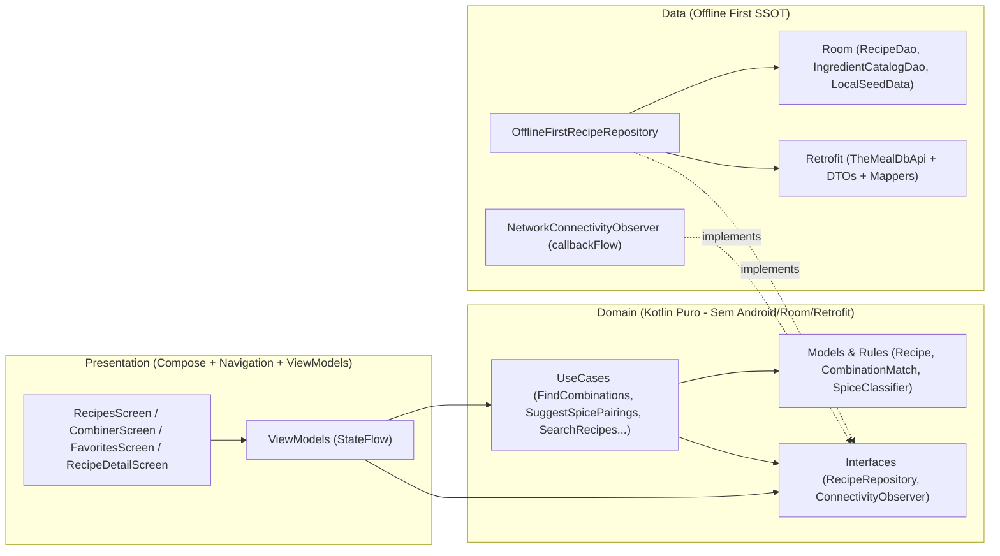
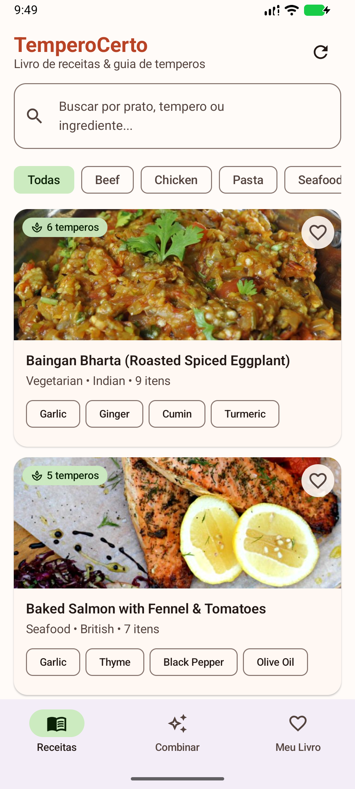
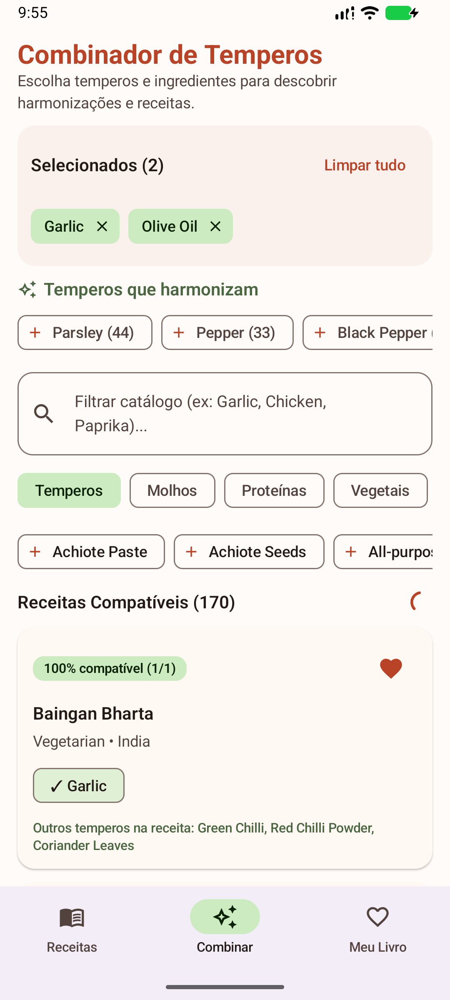
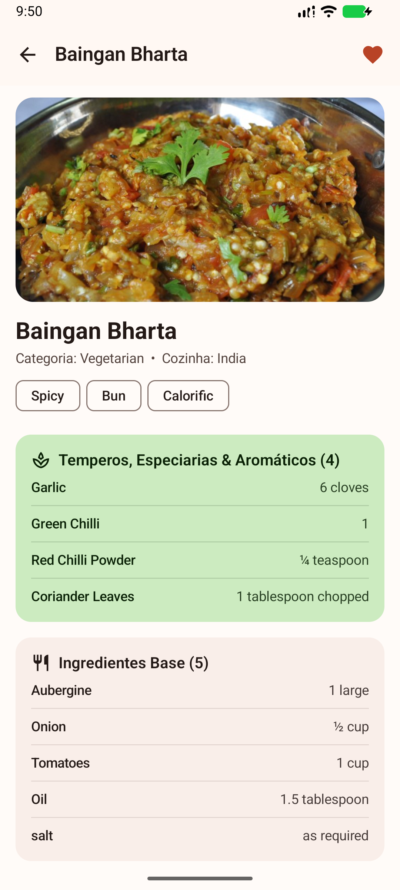
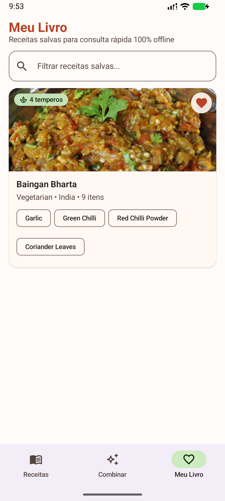
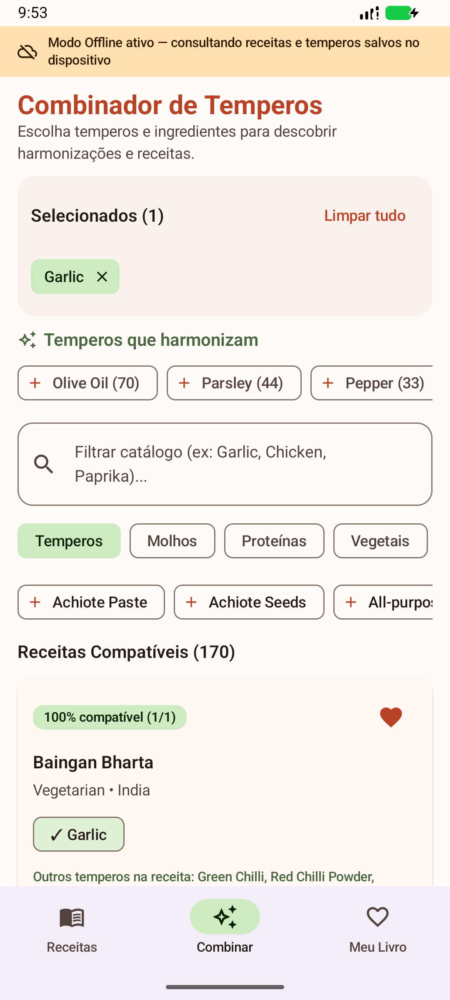

# TemperoCerto — Livro de Receitas & Guia de Harmonização de Temperos

**Autor:** Orlando Vandres — **RA:** 170197  
**Metodologia:** Spec-Driven Development (SDD)  
**Plataforma:** Android (Kotlin + Jetpack Compose + Clean Architecture + Offline First)  
**Package / Application ID:** `br.edu.orlandovandres.temperocerto`

---

## 1. Descrição e Objetivo da Aplicação

O **TemperoCerto** é uma aplicação Android desenvolvida como um **livro de receitas inteligente voltado para a consulta e combinação de temperos e ingredientes**.

### Problema que resolve
No dia a dia na cozinha, muitas pessoas possuem temperos e ingredientes específicos disponíveis em casa, mas enfrentam duas dificuldades recorrentes:
1. Descobrir **quais receitas aproveitam melhor os temperos e ingredientes já disponíveis**;
2. Identificar **quais outros temperos e especiarias harmonizam** com uma determinada base culinária, sem depender exclusivamente de conexão contínua com a internet durante o preparo.

O **TemperoCerto** soluciona esse problema consultando uma base online pública (**TheMealDB API v1**), classificando automaticamente temperos, ervas, condimentos e ingredientes base, sugerindo harmonizações por coocorrência real e mantendo todo o acervo utilizável **100% offline** via persistência local com **Room**.

---

## 2. Funcionalidades Implementadas

- **Catálogo de Receitas Online & Offline (`Receitas`):** listagem reativa via `StateFlow`, busca textual por prato, categoria, cozinha ou ingrediente, e filtragem dinâmica por categorias (`Todas`, `Beef`, `Chicken`, `Pasta`, `Seafood`, `Vegetarian`, etc.).
- **Combinador Inteligente de Temperos & Ingredientes (`Combinar`):**
  - Seleção múltipla de itens através de catálogo pesquisável e segmentado por tipo (*Temperos*, *Molhos*, *Proteínas*, *Vegetais*, *Todos*);
  - **Sugestões de Harmonização (`Temperos que harmonizam`):** calcula automaticamente quais especiarias/condimentos mais coocorrem nas receitas compatíveis com a seleção atual;
  - **Ranqueamento por Afinidade (`matchScore`):** exibe percentual de compatibilidade (ex.: `100% compatível (2/2)`), itens encontrados, itens ausentes e outros temperos usados na receita.
- **Detalhes Estruturados da Receita:** separa explicitamente **Temperos, Especiarias & Aromáticos** de **Ingredientes Base** com suas medidas, exibe tags culinárias, modo de preparo e link seguro para vídeo tutorial no YouTube quando disponível.
- **Meu Livro (`Favoritos`):** permite favoritar e desfavoritar receitas em qualquer tela, mantendo-as salvas localmente no dispositivo mesmo após sincronizações remotas.
- **Indicador de Conectividade & Modo Offline First:** monitora a rede em tempo real (`ConnectivityObserver`), exibe banner informativo quando offline (`Modo Offline ativo — consultando receitas e temperos salvos no dispositivo`) e garante operação contínua sem rede desde a primeira execução via pré-carga local (`LocalSeedData`).

---

## 3. Documentação SDD e Entregáveis do Projeto

| Entregável | Localização | Descrição |
|---|---|---|
| **Especificação SDD (Etapa 1)** | [docs/01-especificacao.md](docs/01-especificacao.md) | Proposta, personas, requisitos funcionais (`RF01`–`RF10`), não funcionais (`RNF01`–`RNF08`) e regras de negócio (`RN01`–`RN05`). |
| **Planejamento Arquitetural (Etapa 2)** | [docs/02-planejamento.md](docs/02-planejamento.md) | Clean Architecture, justificativa da API, estratégia Offline First, matriz de versões e estrutura de pacotes. |
| **Decomposição de Tarefas (Etapa 3)** | [docs/03-decomposicao.md](docs/03-decomposicao.md) | Sequência incremental de tarefas (`T01`–`T11`) mapeada para os commits Git. |
| **Relatório de Testes Unitários** | [TEST_RESULTS.md](TEST_RESULTS.md) | Detalhamento completo dos 18 testes unitários executados e aprovados. |
| **APK Debug (Unsigned)** | [apk/TemperoCerto-debug.apk](apk/TemperoCerto-debug.apk) | APK compilado pronto para instalação em emulador ou dispositivo Android. |

---

## 4. Tecnologias e Bibliotecas Utilizadas

| Categoria | Tecnologia / Biblioteca | Versão | Finalidade |
|---|---|---|---|
| **Linguagem & Build** | Kotlin / AGP / Gradle | `2.0.21` / `8.7.3` / `8.11.1` | Compilação moderna com plugin Compose Compiler e KSP (`2.0.21-1.0.28`) |
| **Interface (UI)** | Jetpack Compose (BOM) + Material 3 | `2024.10.01` | UI declarativa, tema culinário Material 3 e ícones estendidos |
| **Navegação** | Navigation Compose | `2.8.3` | Navegação entre `Receitas`, `Combinar`, `Meu Livro` e `Detalhes` |
| **Injeção de Dependências** | Dagger Hilt + Hilt Navigation Compose | `2.52` / `1.2.0` | DI desacoplada por módulos e `@HiltViewModel` |
| **Assincronismo** | Kotlin Coroutines & Flow / StateFlow | `1.9.0` | Execução em `Dispatchers.IO`, paralelismo (`async/awaitAll`) e UI reativa |
| **Persistência Local** | Room (`room-runtime`, `room-ktx`) | `2.6.1` | Banco SQLite local como *Single Source of Truth* (SSOT) |
| **Rede & API** | Retrofit + OkHttp + Gson | `2.11.0` / `4.12.0` / `2.11.0` | Consumo REST assíncrono, logging HTTP e parsing JSON |
| **Imagens** | Coil Compose | `2.7.0` | Carregamento assíncrono com cache em disco/memória e fallback offline |
| **Testes Unitários** | JUnit 4 + MockK + Turbine + Coroutines Test | `4.13.2` / `1.13.13` / `1.2.0` | Testes unitários de domínio, mappers, repositório e ViewModels |

---

## 5. API REST Utilizada e Justificativa

**API:** **TheMealDB API v1**  
**Endereço base:** `https://www.themealdb.com/api/json/v1/1/`  
**Documentação oficial:** https://www.themealdb.com/api.php

### Justificativa da Escolha
- **Acesso aberto e gratuito:** os endpoints da versão v1 não exigem cadastro de token pago ou OAuth, tornando a aplicação 100% reproduzível para avaliação;
- **Catálogo tipado de ingredientes:** o endpoint `list.php?i=list` fornece centenas de itens com campo `strType` (`Seasoning`, `Spice`, `Sauce`, `Dressing`, `Meat`, `Vegetable`, etc.), ideal para filtrar temperos e especiarias;
- **Receitas completas e ricas:** cada receita disponibiliza até 20 pares ingrediente/medida, modo de preparo, categoria, cozinha regional, foto e vídeo opcional.

### Endpoints Consumidos (`TheMealDbApi`)
| Endpoint | Uso na Aplicação |
|---|---|
| `GET list.php?i=list` | Sincronização do catálogo completo de temperos e ingredientes. |
| `GET search.php?f={letter}` | Carga inicial paralela de receitas (`c`, `b`, `p`, `s`) para popular o cache local. |
| `GET search.php?s={query}` | Pesquisa online de receitas por nome. |
| `GET filter.php?i={ingredient}` | Consulta paralela de receitas candidatas para cada tempero/ingrediente selecionado. |
| `GET lookup.php?i={id}` | Hidratação dos detalhes completos de uma receita. |

> **Nota técnica:** Na v1 gratuita da TheMealDB, `filter.php?i=item1,item2` retorna `meals: null`. Para viabilizar combinações multi-tempero, o repositório executa chamadas paralelas individuais (`async`/`awaitAll`), prioriza IDs por interseção, hidrata os detalhes faltantes via `lookup.php` e calcula o score final sobre a base Room.

---

## 6. Arquitetura e Separação de Camadas (Clean Architecture)

O módulo `:app` segue estritamente a **Clean Architecture** com **Unidirectional Data Flow (UDF)** na camada de apresentação:



### Regra de Dependência
- **`domain/`**: contém apenas Kotlin puro (`models`, `SpiceClassifier`, interfaces `RecipeRepository`/`ConnectivityObserver` e 9 `UseCases`). Não importa Room, Retrofit ou Jetpack Compose.
- **`data/`**: implementa `RecipeRepository` (`OfflineFirstRecipeRepository`), persistência Room (`TemperoDatabase`, DAOs, Entities e `LocalSeedData`), cliente Retrofit (`TheMealDbApi`, DTOs) e mappers (`RecipeMapper`, `IngredientMapper`).
- **`presentation/`**: contém exclusivamente componentes Compose (`@Immutable` states, `collectAsStateWithLifecycle()`, `key` estáveis em `LazyColumn`/`LazyRow`), `ViewModel`s Hilt e rotas do Navigation Compose.
- **`di/` e `util/`**: módulos Hilt (`DispatcherModule`, `DatabaseModule`, `NetworkModule`, `RepositoryModule`) e `NetworkConnectivityObserver` livre de memory leaks (usa `@ApplicationContext` e `callbackFlow` com `awaitClose`).

---

## 7. Estratégia de Funcionamento Offline First

1. **Single Source of Truth (SSOT):** toda observação da UI (`observeRecipes`, `observeFavoriteRecipes`, `observeRecipeById`, `observeIngredientCatalog`) lê diretamente `Flow`s do banco **Room**.
2. **Pré-carga Local Imediata (`LocalSeedData`):** caso o banco esteja vazio na primeira abertura (mesmo sem internet), o repositório popula imediatamente 8 receitas ricas em temperos e 30 ingredientes/especiarias essenciais.
3. **Sincronização Incremental e Preservação de Favoritos:** ao sincronizar online com a TheMealDB (respeitando TTL de 12 horas ou atualização manual), os IDs favoritados no Room (`getFavoriteIds()`) são preservados em todos os *upserts*.
4. **Fallback Transparente:** em buscas ou combinações sem conectividade (ou diante de `IOException`/timeout), o repositório trata exceções de rede sem derrubar a UI e responde com os dados persistidos localmente, enquanto `ConnectivityObserver` ativa o banner visual de **Modo Offline**.

---

## 8. Configuração, Execução e Geração do APK

### Pré-requisitos
- Android Studio Ladybug/Meerkat ou superior (ou **JDK 17/21** + **Android SDK** com plataforma `android-36`).
- O projeto inclui o **Gradle Wrapper (`8.11.1`)**, não sendo necessário instalar o Gradle globalmente.

### Passo a passo via terminal
1. Clone o repositório:
   ```bash
   git clone <url-do-repositorio>
   cd orlando-sdd
   ```
2. Garanta que `local.properties` na raiz aponta para o seu Android SDK (gerado automaticamente pelo Android Studio, ou crie manualmente):
   ```properties
   sdk.dir=C\:\\Users\\seu_usuario\\AppData\\Local\\Android\\Sdk
   ```
3. Compile e gere o APK de depuração (unsigned debug APK):
   - **Windows (PowerShell):**
     ```powershell
     .\gradlew.bat assembleDebug
     ```
   - **Linux/macOS:**
     ```bash
     ./gradlew assembleDebug
     ```
   - O APK gerado ficará disponível em `app/build/outputs/apk/debug/app-debug.apk` (também disponibilizado em [apk/TemperoCerto-debug.apk](apk/TemperoCerto-debug.apk)).
4. Para instalar diretamente em um emulador ou dispositivo conectado via ADB:
   ```bash
   adb install -r apk/TemperoCerto-debug.apk
   ```

---

## 9. Execução e Evidências dos Testes Unitários

Execute a suíte de testes unitários com:
- **Windows:** `.\gradlew.bat testDebugUnitTest`
- **Linux/macOS:** `./gradlew testDebugUnitTest`

### Resumo dos Resultados (`18/18 PASSED`)
| Suíte | Quantidade | Resultado | Cobertura Principal |
|---|---:|---|---|
| `FindCombinationsUseCaseTest` | 4 | **PASSED** | `matchScore`, ordenação por afinidade/favoritos, substring case-insensitive, erro |
| `SuggestSpicePairingsUseCaseTest` | 1 | **PASSED** | Ranking por coocorrência e exclusão de neutros/já selecionados |
| `RecipeUseCasesTest` | 3 | **PASSED** | `SearchRecipesUseCase`, `ToggleFavoriteRecipeUseCase`, `SpiceClassifier` |
| `RecipeMapperTest` | 2 | **PASSED** | Extração dos 20 slots da API e preservação de `isFavorite` |
| `OfflineFirstRecipeRepositoryTest` | 4 | **PASSED** | Preservação de favoritos no sync, fallback offline e `toggleFavorite` |
| `CombinerViewModelTest` | 2 | **PASSED** | `StateFlow` de seleção/combinação/sugestões e banner offline |
| `RecipesViewModelTest` | 2 | **PASSED** | Filtros por categoria/texto e tratamento de erro mantendo cache |

Relatório detalhado disponível em [TEST_RESULTS.md](TEST_RESULTS.md).

---

## 10. Evidências Visuais (Execução Online e Modo Offline no Emulador)

| 1. Tela Inicial (Online + Sync TheMealDB) | 2. Combinador de Temperos & Harmonização | 3. Detalhes da Receita (Temperos vs Base) |
|---|---|---|
|  |  |  |

| 4. Meu Livro (Favoritos Offline) | 5. Funcionamento Completo Sem Internet (Modo Offline) |
|---|---|
|  |  |

---

## 11. Limitações Conhecidas e Melhorias Futuras

- **Idioma da Base Remota:** A API pública TheMealDB v1 disponibiliza nomes de pratos, ingredientes e instruções originalmente em inglês; o aplicativo apresenta toda a interface, classificações e orientações em português, mantendo os termos originais da base para compatibilidade precisa de busca.
- **Filtro Múltiplo na API Gratuita:** Como o endpoint gratuito `filter.php?i=` aceita apenas um ingrediente por requisição, combinações com muitos itens consultam até 4 ingredientes em paralelo na rede e refinam o ranqueamento completo sobre a base local Room.
- **Melhorias Futuras:** Suporte a cadastro autoral de receitas pelo próprio usuário, lista de compras integrada para ingredientes ausentes e tradução opcional sob demanda das instruções.
