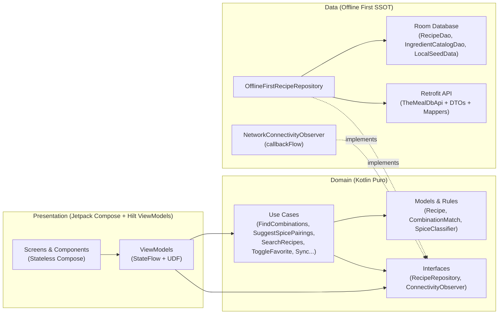

# Planejamento Arquitetural — TemperoCerto (SDD - Etapa 2)

**Autor:** Orlando Vandres — **RA:** 170197  
**Baseado em:** [docs/01-especificacao.md](file:///c:/Users/orlan/Projects/orlando-sdd/docs/01-especificacao.md)

---

## 1. Arquitetura do Sistema (Clean Architecture)

O projeto adota **Clean Architecture** organizada em três camadas concêntricas dentro do módulo `:app`, respeitando rigorosamente a **Regra de Dependência** (camadas externas dependem das internas; `domain` é 100% independente de frameworks Android, Room e Retrofit):



### Regra de Dependência e Responsabilidades
- **`presentation`**: Telas Jetpack Compose, componentes reutilizáveis, tema Material 3, Navigation Compose (`NavHost` + `NavigationBar`) e `ViewModel`s expondo `StateFlow<UiState>`. Nunca acessa DAO, Retrofit ou DTOs diretamente.
- **`domain`**: Modelos de negócio imutáveis (`Recipe`, `IngredientMeasure`, `CatalogIngredient`, `CombinationMatch`, `SpicePairingSuggestion`, `IngredientKind`), classificador culinário (`SpiceClassifier`), interfaces de repositório/conectividade e casos de uso puros (`UseCase`).
- **`data`**: Implementação do repositório Offline First, banco local Room (entidades, DAOs e *seed* curado), cliente REST Retrofit (API, DTOs), mappers (`Dto -> Entity -> Domain`) e observador reativo de rede.
- **`di`**: Módulos Hilt (`DispatcherModule`, `DatabaseModule`, `NetworkModule`, `RepositoryModule`) ligando abstrações às implementações.

---

## 2. Escolha e Documentação da API REST

**API escolhida:** **TheMealDB API v1** (`https://www.themealdb.com/api/json/v1/1/`)

### Justificativa
1. **Acesso público e gratuito:** não exige cadastro de chave privada ou OAuth para os endpoints v1, garantindo reprodutibilidade imediata na avaliação acadêmica.
2. **Catálogo estruturado de ingredientes e temperos:** o endpoint `list.php?i=list` retorna centenas de ingredientes com `strType` tipado (`Seasoning`, `Spice`, `Sauce`, `Dressing`, `Meat`, `Vegetable`, etc.) e miniaturas oficiais.
3. **Receitas completas:** cada receita possui até 20 pares `strIngredient1..20` / `strMeasure1..20`, instruções detalhadas, categoria, região culinária, tags e vídeo tutorial opcional.

### Endpoints Consumidos
| Endpoint | Método | Finalidade no TemperoCerto |
|---|---|---|
| `list.php?i=list` | `GET` | Sincroniza o catálogo de ingredientes e temperos (`IngredientCatalogEntity`). |
| `search.php?f={letter}` | `GET` | Carga inicial e renovação do acervo de receitas em paralelo (`c`, `b`, `p`, `s`). |
| `search.php?s={query}` | `GET` | Busca remota de receitas por nome quando o usuário pesquisa online. |
| `filter.php?i={ingredient}` | `GET` | Descoberta de receitas candidatas que contêm um ingrediente ou tempero específico. |
| `lookup.php?i={id}` | `GET` | Hidratação dos detalhes completos de uma receita (ingredientes, medidas e preparo). |

> **Observação técnica verificada:** Na API v1 gratuita, `filter.php?i=Garlic,Chicken` (múltiplos itens separados por vírgula) retorna `meals: null`. Por isso, o `OfflineFirstRecipeRepository` dispara chamadas paralelas individuais `filterMealsByIngredient(item)` com `async/awaitAll`, calcula a interseção de IDs no cliente, hidrata os detalhes faltantes via `lookupMealById` e executa o ranqueamento final sobre a base Room.

---

## 3. Estratégia Offline First e Sincronização

O banco **Room** atua como **Single Source of Truth (SSOT)** para toda a aplicação:

1. **Pré-carga Local Imediata (`LocalSeedData`):** Na primeira inicialização (ou caso o banco esteja vazio), o repositório garante a inserção de 8 receitas clássicas ricas em temperos e 30 temperos/ingredientes essenciais. Mesmo que o dispositivo abra o app pela primeira vez em **Modo Avião**, todas as telas (Receitas, Combinar, Detalhes e Meu Livro) já funcionam imediatamente.
2. **Hidratação e Sincronização em Background:** Quando há conexão (`ConnectivityObserver.isOnline`), o `syncCatalog()` consulta `list.php?i=list` e lotes iniciais por letra (`c`, `b`, `p`, `s`) usando `Dispatchers.IO` e `async/awaitAll`, fazendo *upsert* no Room.
3. **Preservação de Favoritos (`isFavorite`):** Antes de qualquer `upsertRecipes` ou `upsertRecipe` vindo da API, o repositório consulta `recipeDao.getFavoriteIds()` / `getRecipeById()` e preserva `isFavorite = true` nas receitas marcadas pelo usuário.
4. **Resiliência a Falhas de Rede:** Falhas (`IOException`, `HttpException`) nunca derrubam a interface nem geram crashes; o erro é tratado com `runCatching` (sempre relançando `CancellationException`) e a UI continua operando com os dados locais do Room.

---

## 4. Stack Tecnológica e Matriz de Versões

| Tecnologia | Versão | Papel |
|---|---|---|
| **Kotlin / AGP / Gradle** | `2.0.21` / `8.7.3` / `8.11.1` | Linguagem, compilação e Compose Compiler plugin |
| **Jetpack Compose (BOM)** | `2024.10.01` | UI declarativa Material 3 e ícones estendidos |
| **Navigation Compose** | `2.8.3` | Navegação entre Receitas, Combinar, Favoritos e Detalhes |
| **Dagger Hilt + KSP** | `2.52` / `2.0.21-1.0.28` | Injeção de dependências com geração em tempo de compilação |
| **Room** | `2.6.1` | Persistência local SQLite reativa com `Flow` |
| **Retrofit + OkHttp + Gson** | `2.11.0` / `4.12.0` / `2.11.0` | Consumo REST, logging e serialização JSON |
| **Kotlin Coroutines** | `1.9.0` | Concorrência estruturada e `StateFlow` |
| **Coil Compose** | `2.7.0` | Carregamento assíncrono e cache de imagens |
| **JUnit4 + MockK + Turbine** | `4.13.2` / `1.13.13` / `1.2.0` | Testes unitários de domínio, repositório e ViewModels |

---

## 5. Qualidade, Performance no Compose e Prevenção de Memory Leaks

- **Otimização de Recomposições:** Classes de estado anotadas com `@Immutable`, uso de `key = { it.id }` em `LazyColumn`/`LazyRow`, coleta consciente de ciclo de vida com `collectAsStateWithLifecycle()` e separação entre `Route` (stateful com `hiltViewModel()`) e `Screen` (stateless).
- **Prevenção de Memory Leaks:** Uso exclusivo de `@ApplicationContext` em singletons (`NetworkConnectivityObserver`, `TemperoDatabase`), `callbackFlow` com `awaitClose { connectivityManager.unregisterNetworkCallback(...) }`, e zero referências a `Activity` ou `View` dentro de ViewModels.

---

## 6. Estrutura de Pacotes (`br.edu.orlandovandres.temperocerto`)

```text
app/src/main/java/br/edu/orlandovandres/temperocerto/
├── TemperoCertoApplication.kt
├── MainActivity.kt
├── di/
│   ├── DatabaseModule.kt
│   ├── DispatcherModule.kt
│   ├── NetworkModule.kt
│   └── RepositoryModule.kt
├── domain/
│   ├── model/
│   │   ├── CatalogIngredient.kt
│   │   ├── CombinationMatch.kt
│   │   ├── IngredientKind.kt
│   │   ├── IngredientMeasure.kt
│   │   ├── Recipe.kt
│   │   ├── SpiceClassifier.kt
│   │   ├── SpicePairingSuggestion.kt
│   │   └── SyncSummary.kt
│   ├── repository/
│   │   ├── ConnectivityObserver.kt
│   │   └── RecipeRepository.kt
│   └── usecase/
│       ├── FindCombinationsUseCase.kt
│       ├── GetRecipeDetailUseCase.kt
│       ├── ObserveFavoriteRecipesUseCase.kt
│       ├── ObserveIngredientCatalogUseCase.kt
│       ├── ObserveRecipesUseCase.kt
│       ├── SearchRecipesUseCase.kt
│       ├── SuggestSpicePairingsUseCase.kt
│       ├── SyncCatalogUseCase.kt
│       └── ToggleFavoriteRecipeUseCase.kt
├── data/
│   ├── local/
│   │   ├── LocalSeedData.kt
│   │   ├── TemperoDatabase.kt
│   │   ├── dao/ (IngredientCatalogDao, RecipeDao)
│   │   └── entity/ (IngredientCatalogEntity, RecipeEntity)
│   ├── mapper/ (IngredientMapper, RecipeMapper)
│   ├── remote/
│   │   ├── api/ (TheMealDbApi)
│   │   └── dto/ (FilteredMealDto, IngredientDto, MealDto...)
│   └── repository/ (OfflineFirstRecipeRepository)
├── util/
│   └── NetworkConnectivityObserver.kt
└── presentation/
    ├── theme/ (Color, Theme, Type)
    ├── components/ (OfflineBanner, RecipeCard, StateViews)
    ├── navigation/ (Screen, TemperoCertoAppRoot)
    ├── recipes/ (RecipesScreen, RecipesUiState, RecipesViewModel)
    ├── combiner/ (CombinerScreen, CombinerUiState, CombinerViewModel)
    ├── detail/ (RecipeDetailScreen, RecipeDetailUiState, RecipeDetailViewModel)
    └── favorites/ (FavoritesScreen, FavoritesUiState, FavoritesViewModel)
```
